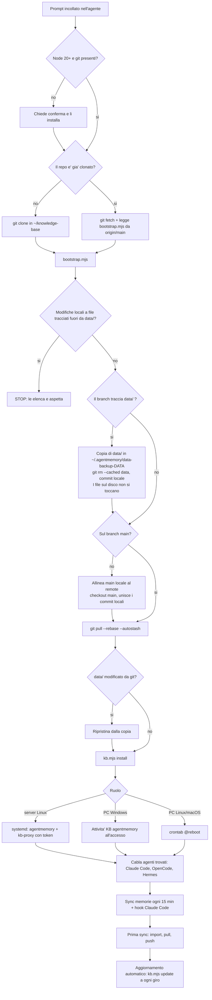

# Flusso di installazione

Errori e cosa fare:

| Dove | Sintomo | Cosa fare |
|------|---------|-----------|
| fetch/pull/push | timeout o `CONNECT tunnel failed` | `git config http.proxy ""` solo per il repo |
| bootstrap | modifiche locali fuori da data/ | `git stash` o scartarle a mano, rilanciare |
| bootstrap | merge/rebase in corso | `git merge --abort` o `git rebase --abort`, rilanciare |
| install | Node < 20 | installare Node 20+ |
| install | agentmemory non risponde | log in `~/.agentmemory/agentmemory.log` |
| sync | push chiede la password | Git Credential Manager o chiave SSH, rilanciare |
